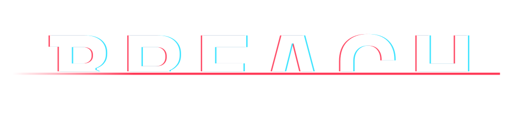

<p align="center">
  
</p>

# breach-game.github.io

The presentation site of [BREACH](https://github.com/breach-game/breach), the cybersecurity thriller that runs in your browser. Published at **https://breach-game.github.io/**, in English and French. The game itself is at https://breach-game.github.io/breach/.

## What is in it

- A landing page with a living network map in the hero, four explainer films and a gallery of real screenshots.
- A documentation page: how to play, every command, scoring, characters and the optional API key, privacy, and how to write a community mission.
- English at `/`, French at `/fr/`.

Everything is made in the browser, as in the game:

- **The films are not videos.** `assets/js/films.js` draws each one on a canvas as a pure function of time, so they weigh a few kilobytes, can be scrubbed, and their captions are real, translatable text.
- **The music is not a file.** `assets/js/music.js` generates a slow dark-synth loop with the Web Audio API, like the game’s own soundtrack. No licence question, nothing to download. It plays only after the visitor presses the sound button, and its tension follows the section being read.
- **No third party, no cookie.** Fonts are self-hosted (Space Grotesk, JetBrains Mono). Visits are counted with a self-hosted [Umami](https://umami.is/) at `umami.mornati.net` (cookieless, no personal data, Do Not Track honoured); clicks on a Play button are counted as the `play` event. The game itself has no analytics. A strict Content Security Policy with Trusted Types is set in every page, and only allows Umami's origin besides the site's own.
- **Accessible.** Real buttons, visible focus, 44 px targets, captions in a live region, and `prefers-reduced-motion` stops every animation.

## Layout

| Path | Role |
| --- | --- |
| `src/content.mjs` | every string of the landing pages, in English and French |
| `src/docs.mjs` | the documentation, in English and French |
| `src/build.mjs` | turns the two files above into the HTML pages |
| `index.html`, `fr/`, `docs/`, `fr/docs/`, `404.html` | generated pages, committed so that Pages serves the repository as it is |
| `assets/css/site.css` | styles, using the game’s colour tokens |
| `assets/js/` | `main.js` (page behaviour), `hero.js` (network map), `films.js` (explainer films), `music.js` (soundtrack) |
| `assets/img/shots/` | screenshots of the game, from `breach/docs/screens`, as WebP |
| `assets/brand/` | logo, favicon and social preview, from the brand kit |

## Editing

Change a text in `src/`, then rebuild the pages and check them locally:

```bash
node src/build.mjs
python3 -m http.server 8000   # then open http://localhost:8000/
```

Node 22 or later, no dependency to install. Colour carries meaning, as in the game: red is attack, cyan is defence, violet is AI, green is success only, amber is noise and detection.

## Publishing

GitHub Pages serves the `main` branch from the repository root (`.nojekyll` turns off Jekyll). A merge to `main` is live a minute later.
